

#  R&R Pavers Group 

> Visite o site: [R&R Pavers Group — Landing Page](https://rer-pavers-group.vercel.app/)

 

## Sobre o projeto

Landing page da **R&R Pavers Group LLC**, empresa de pavers e hardscape da região de Tampa Bay, na Flórida. O site é todo em inglês e foi pensado para quem procura um pool deck, um pátio ou uma entrada de garagem e quer pedir um orçamento sem complicação.

A ideia parte do próprio ofício: **cada peça no lugar**. O símbolo da marca, um losango de pavers, se monta peça por peça na abertura e volta em 3D na seção Sobre, onde os pavers caem e se encaixam conforme a rolagem. As fotos dos serviços se revelam como um piso sendo assentado, os ícones se desenham ao passar o mouse e o mapa de atendimento se desenha a partir de Tampa.

A página apresenta os dez serviços da empresa, dá destaque ao antes e depois das obras, organiza a galeria por tipo de trabalho e termina em um formulário de orçamento com envio de fotos. Ligação, mensagem e pedido de orçamento ficam sempre a um toque.

 

## Prévia

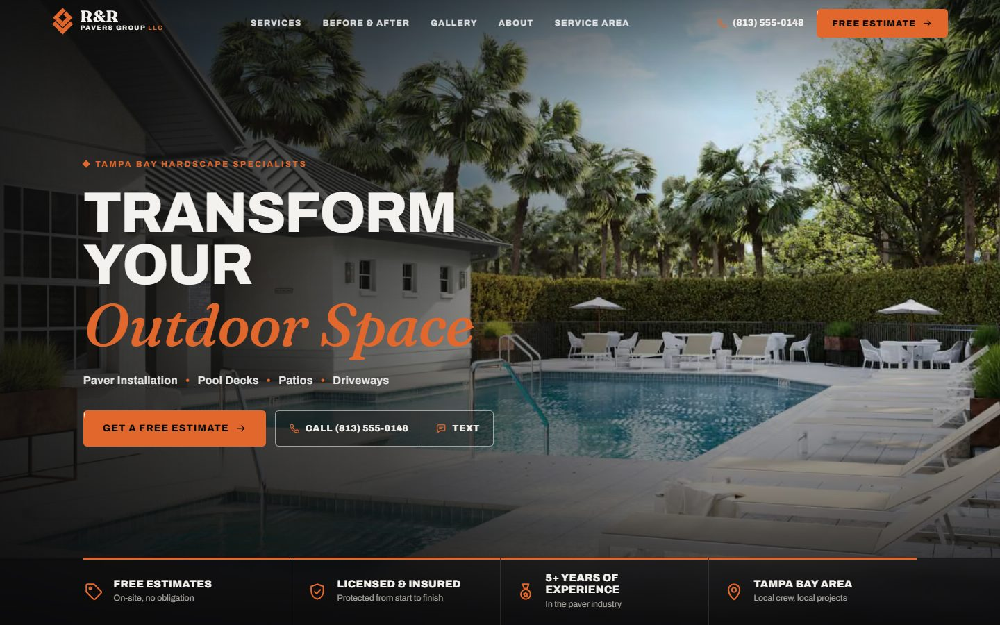

<table>
  <tr>
    <td width="50%">
      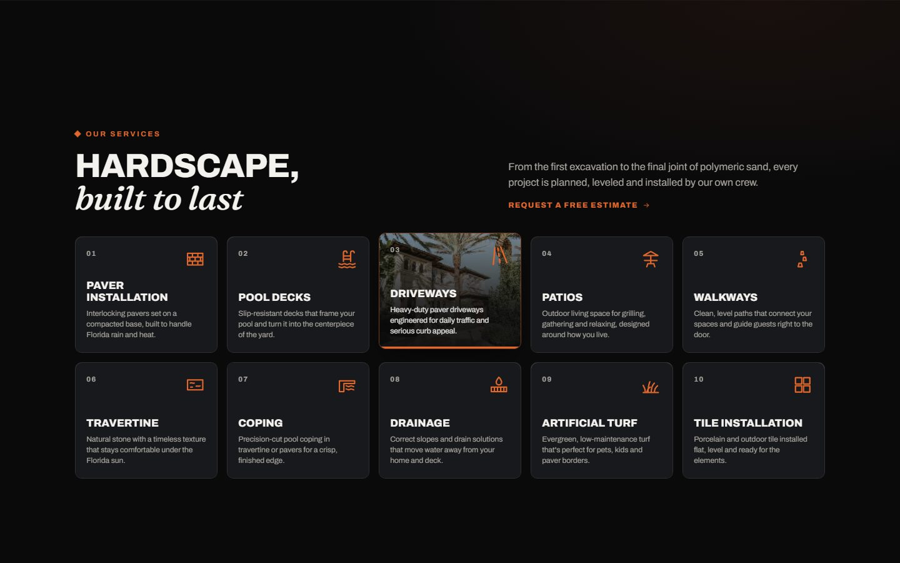
      
<b>Dez serviços, uma especialidade</b> Cada card revela a foto da obra, peça por peça, ao passar o mouse

    </td>
    <td width="50%">
      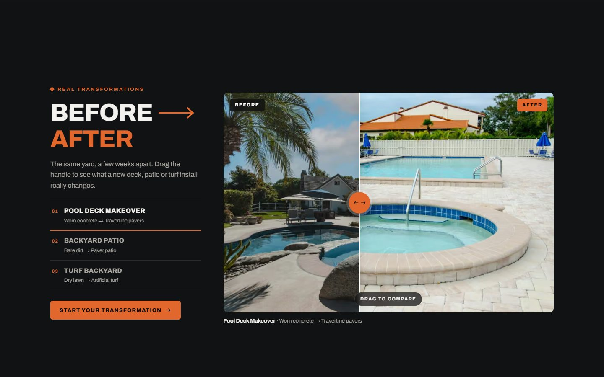
      
<b>Antes e depois na rolagem</b> A tela fica fixa enquanto o concreto gasto vira travertino

    </td>
  </tr>
  <tr>
    <td width="50%">
      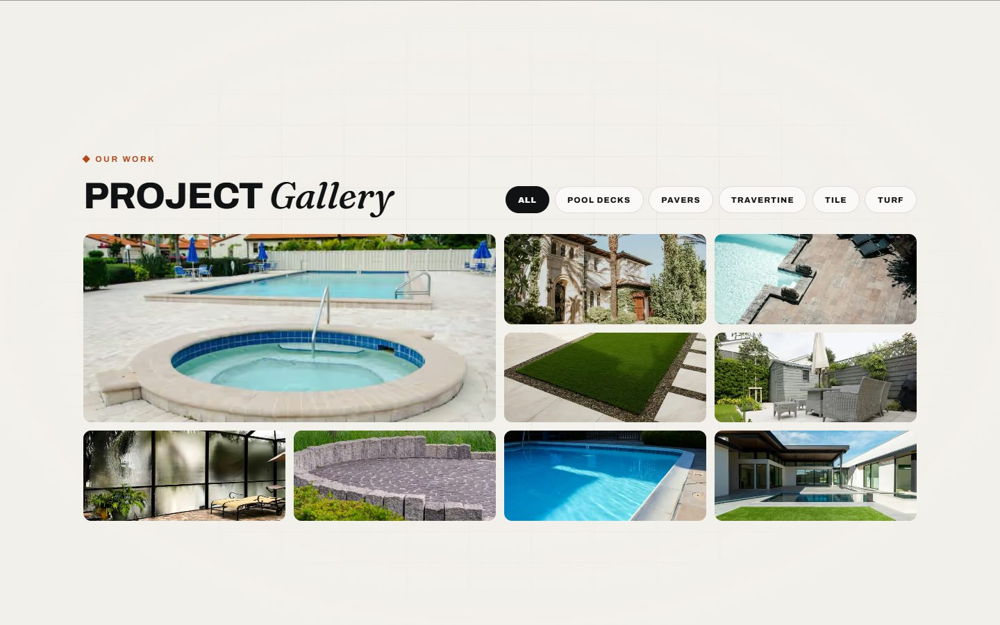
      
<b>Obras organizadas por tipo</b> Pool decks, pavers, travertino, porcelanato e grama sintética

    </td>
    <td width="50%">
      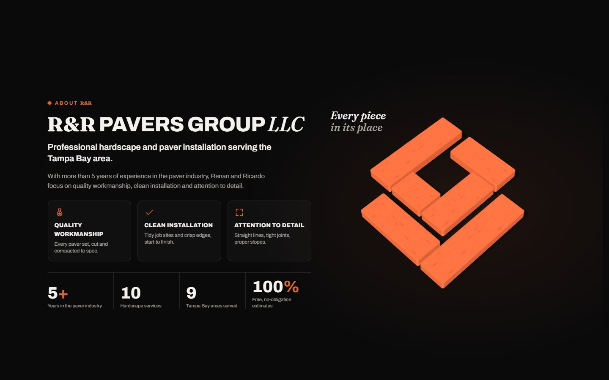
      
<b>Cada peça no lugar</b> O símbolo da R&R se monta em 3D conforme a rolagem

    </td>
  </tr>
  <tr>
    <td width="50%">
      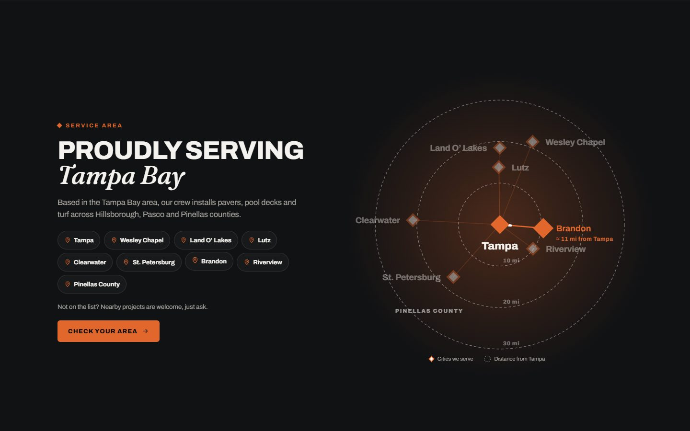
      
<b>Tampa Bay no mapa</b> Ao passar o mouse, a rota até cada cidade se acende e mostra a distância

    </td>
    <td width="50%">
      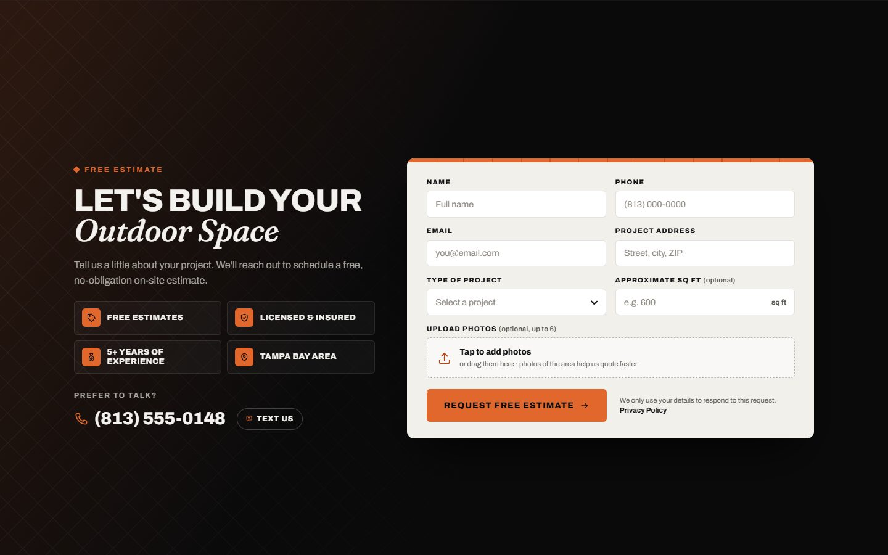
      
<b>Orçamento em poucos passos</b> Formulário curto, com envio de fotos e contato direto

    </td>
  </tr>
</table>

### No celular

A abertura com os pavers também roda no celular. No hero, o título fica no alto e os serviços e os botões de orçamento, ligação e mensagem ficam juntos embaixo, deixando a foto respirar. A barra fixa **Call Now | Get Free Estimate** aparece a partir da segunda seção, o antes e depois se transforma sozinho quando aparece na tela e os cards de serviço revelam a foto com um toque ou segurando o dedo.

  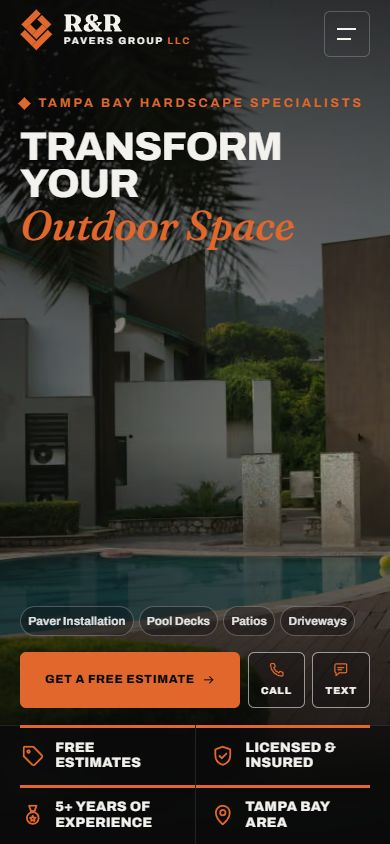
  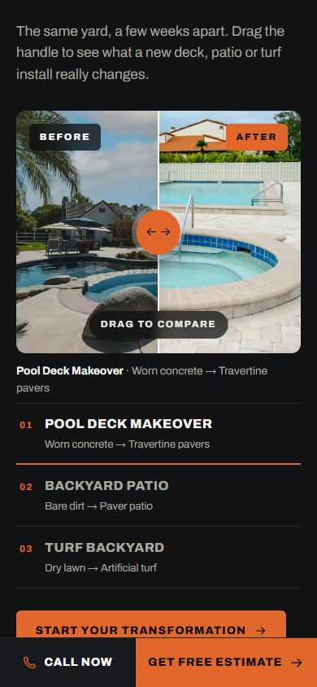
  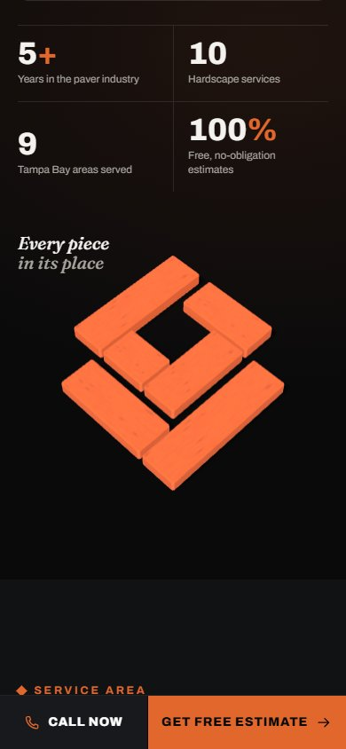

 

## Destaques

- **Abertura com a marca**: a cada visita, os pavers do símbolo se assentam um a um e a tela se abre para revelar a página.
- **Confiança em primeiro plano**: Free Estimates, Licensed & Insured, 5+ Years of Experience e Tampa Bay Area logo abaixo da chamada principal.
- **Antes e depois em evidência**: a própria rolagem transforma o "antes" no "depois"; em seguida, a comparação fica com o visitante, arrastando ou pelo teclado.
- **Galeria por tipo de obra**: filtros com transição suave e visualização das fotos em tela cheia.
- **Pavers em 3D**: o símbolo da R&R montado peça por peça, respondendo ao mouse e ao toque.
- **Área de atendimento desenhada**: Tampa no centro e as cidades atendidas ao redor, nas posições reais; ao passar o mouse, a rota até cada cidade se acende e mostra a distância até Tampa.
- **Orçamento sem atrito**: formulário curto, envio de fotos do local e validação em tempo real, com ligação e mensagem sempre visíveis.
- **Detalhes no hover**: todo ícone se desenha de novo ao passar o mouse, e os botões ganham um "paver" que desliza por baixo do texto.
- **Leve e acessível**: animações feitas para não pesar no carregamento, foco visível, navegação por teclado e respeito à preferência de reduzir movimento.

 

## Identidade visual

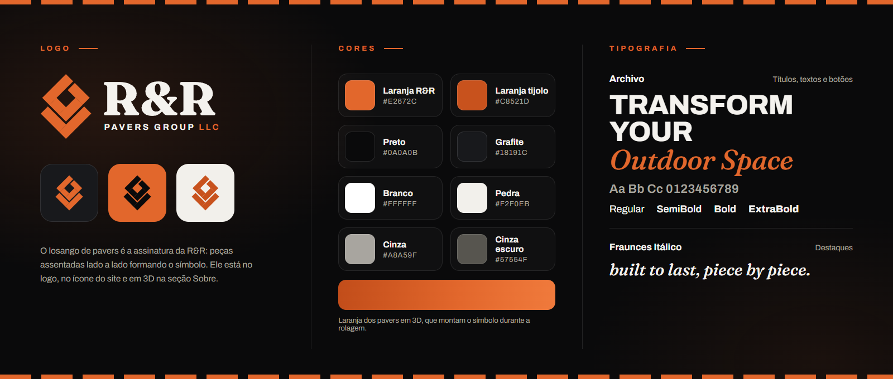

- **Logo**: o losango de pavers em laranja, acompanhado do R&R em serifa e de "Pavers Group LLC". O símbolo também funciona sozinho: é o ícone do site e ganha volume em 3D na seção Sobre.
- **Cores**: preto e grafite nas seções escuras, branco e pedra nas áreas de leitura e o laranja da marca nos destaques e chamadas. Nos pavers em 3D, o laranja ganha um degradê de tijolo.
- **Tipografia**: Archivo nos títulos, textos e botões, firme como o próprio trabalho; Fraunces itálico nos destaques, da mesma família serifada do R&R do logo.

 

## Tecnologias

      

 

## Código-fonte

> [!NOTE]
> O código-fonte deste projeto é **privado**. Este README apresenta o trabalho e sua experiência visual.

 

## Direitos

A marca R&R Pavers Group e o seu logotipo pertencem aos respectivos titulares. As imagens desta apresentação são capturas da própria landing page. As fotos de obras exibidas no momento são provisórias, de banco de imagens de uso livre (Unsplash), e serão substituídas pelos trabalhos reais da empresa.

A reprodução ou reutilização do código, do design e dos materiais depende de autorização de seus titulares. As bibliotecas utilizadas permanecem sujeitas às próprias licenças.

<!-- Desenvolvido por: Guilherme Francisco Pereira -->
